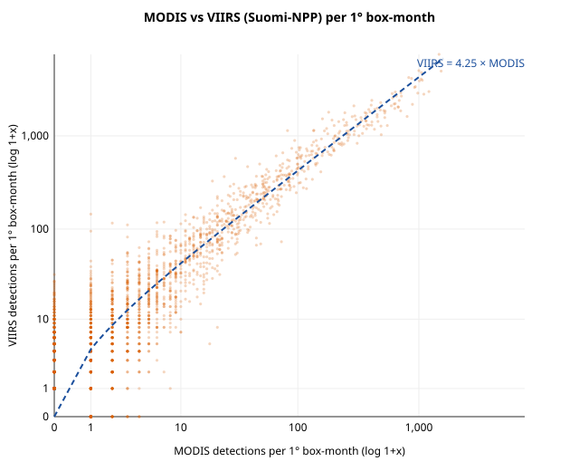

# Harmonization validation report

Overlap period analyzed: **2013-01-01 → 2013-12-31** (MODIS = Terra + Aqua, VIIRS = Suomi-NPP, vegetation fires `type = 0`).

## Ratios (ratio of sums)

| ratio | value | MODIS detections | VIIRS detections |
|---|---|---|---|
| day | 3.692 | | |
| night | 8.058 | | |
| total | 4.246 | 76,878 | 326,448 |

k_FRP = ΣFRP_MODIS / ΣFRP_VIIRS = **0.954**. Terra factor (Terra+Aqua)/Terra = **2.223** (2003-01-01 → 2011-12-31).

Seasonal check (dry months [1, 2, 3, 4, 5]): total ratio dry **4.107** vs rest **5.121** (day 3.555 vs 4.561, night 7.946 vs 8.711). Box CV WAPE one set 25.2% vs per season 25.0%: **simple**.

## Leave-one-month-out cross-validation

| level | ratios | MAPE | WAPE | r² | n |
|---|---|---|---|---|---|
| national | day/night | 12.4% | 8.2% | 0.988 | 12 |
| national | single | 12.6% | 9.6% | 0.987 | 12 |
| 1.0° boxes | day/night | 66.6% | 25.2% | 0.938 | 2204 |
| 1.0° boxes | single | 67.2% | 28.3% | 0.918 | 2204 |

MAPE over box-months is dominated by tiny counts (1 vs 3 = 200 %); WAPE is the fair summary.

## Test 1: stability over time (reference 2013)

| year | day | night | total | Δday | Δnight | Δtotal | k_FRP | MODIS |
|---|---|---|---|---|---|---|---|---|
| 2013 | 3.692 | 8.058 | 4.246 | +0.0% | +0.0% | +0.0% | 0.954 | 76,878 |

Largest |Δ| vs 2013: day 0.0%, night 0.0%, total 0.0%. Correlation with year: day None, night None, total None.

Fit with 2013, predict another year:

| predicted year | national MAPE | national WAPE | box WAPE | box r² |
|---|---|---|---|---|

| variant | box WAPE | box r² | national MAPE | national WAPE |
|---|---|---|---|---|
| fixed_reference_year (ratios of 2013 applied to every other year) | – | None | – | – |
| pooled_all_years (one set fitted on all overlap years, leave-one-month-out) | 25.2% | 0.938 | 12.4% | 8.2% |
| per_year (one set per year, leave-one-month-out within the year) | 25.2% | 0.938 | 12.4% | 8.2% |

Per-year vs pooled box WAPE improvement: 0.0%. **Decision: simple.**

## Test 2: regions

Rule: north lat>=24; center 19-24; southeast lat<19 & lon>=-92; south the rest (1° box SW corner).

| region | day | night | total | Δday | Δnight | Δtotal | MODIS |
|---|---|---|---|---|---|---|---|
| north | 4.094 | 10.063 | 5.223 | +10.9% | +24.9% | +23.0% | 9,939 |
| center | 3.748 | 8.166 | 4.194 | +1.5% | +1.3% | -1.2% | 28,549 |
| south | 3.628 | 7.571 | 4.194 | -1.7% | -6.0% | -1.2% | 28,829 |
| southeast | 3.334 | 5.652 | 3.543 | -9.7% | -29.9% | -16.6% | 9,561 |

Box CV WAPE national ratios 25.2% vs regional 24.7% (improvement 0.5%). **Decision: simple.**

## Test 3: proportionality (box-months)

2,204 box-months. Line VIIRS = 16.418 + 3.776 · MODIS (intercept = 11.1% of the mean VIIRS count; slope through origin 3.812).

| size (MODIS units) | box-months | ΣVIIRS/ΣMODIS | WAPE | MAPE | bias |
|---|---|---|---|---|---|
| 0–1 | 704 | 12.395 | 310.5% | 65.6% | +179.2% |
| 1–3 | 429 | 4.671 | 94.9% | 78.0% | +10.9% |
| 3–5 | 189 | 4.161 | 65.1% | 97.7% | +1.4% |
| 5–10 | 236 | 4.368 | 53.4% | 82.9% | +6.8% |
| 10–20 | 180 | 4.661 | 46.6% | 75.5% | +12.1% |
| 20–50 | 187 | 4.614 | 32.7% | 38.5% | +9.2% |
| 50–100 | 115 | 4.809 | 30.5% | 38.3% | +15.0% |
| 100–300 | 97 | 4.856 | 25.6% | 30.3% | +13.2% |
| ≥ 300 | 67 | 3.772 | 17.6% | 17.2% | -12.5% |

Minimum reliable monthly count (every larger bin has WAPE ≤ 30.0%): **100**. Smallest count from which every bin has |bias| ≤ 10.0% (the ratio itself holds): **None**.

## Test 4: gaps (clouds or missing data)

| satellite | days without any detection | longest runs |
|---|---|---|
| Terra | 93 | 2001-06-15→2001-07-03 (19 d), 2022-10-11→2022-10-23 (13 d), 2002-03-20→2002-03-28 (9 d) |
| Aqua | 44 | 2022-04-01→2022-04-16 (16 d), 2002-07-30→2002-08-07 (9 d), 2002-09-12→2002-09-13 (2 d) |
| SNPP | 53 | 2022-07-27→2022-08-10 (15 d), 2024-07-10→2024-07-15 (6 d), 2026-07-11→2026-07-16 (6 d) |

Fire-season box-months (months [1, 2, 3, 4, 5]) in boxes whose median MODIS count is ≥ 10: **4400**; with 0 detections in both sensors: **21** (0.5%). Not corrected; reported as a limitation.

Examples: 2004-04 box (27, -109) median 25, 2004-04 box (24, -99) median 11, 2004-04 box (26, -109) median 12, 2004-05 box (18, -88) median 11, 2005-04 box (27, -109) median 25, 2005-04 box (26, -109) median 12, 2005-04 box (28, -109) median 15, 2005-05 box (28, -109) median 60, 2006-05 box (19, -100) median 10, 2007-01 box (23, -99) median 12
